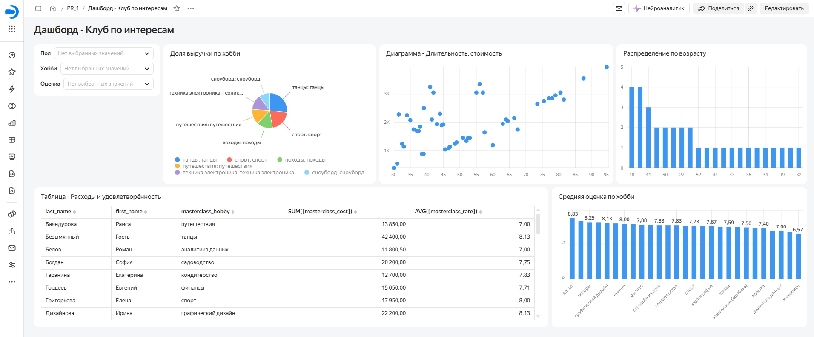

# Интерактивный дашборд мониторинга активности и выручки клуба по интересам

Разработка интерактивного BI-дашборда в Yandex DataLens по данным посещаемости мастер-классов ($n = 250$).

**Инструменты и стек:** Yandex DataLens, Excel, визуализация данных, анализ данных  
**Интерактивный дашборд:** [открыть в Yandex DataLens](https://datalens.yandex/uxf7f92g5bsid?_share_link=public)

---

## Дашборд

*Нажмите на скриншот, чтобы открыть интерактивную версию с работающими фильтрами.*

---

## Задачи проекта

1. Проектирование модели данных: разметка полей на измерения и показатели, настройка типов данных и агрегаций.
2. Построение визуализаций:
   * **Доля выручки по хобби** — круговая диаграмма (pie chart);
   * **Длительность и стоимость** — диаграмма рассеяния (scatter plot) для оценки взаимосвязи;
   * **Распределение по возрасту** — гистограмма с шагом 5 лет;
   * **Расходы и удовлетворённость** — таблица с суммой расходов и средней оценкой по каждому клиенту;
   * **Средняя оценка по хобби** — столбчатая диаграмма с подписями значений.
3. Сквозная фильтрация дашборда через связанные селекторы: пол, хобби, оценка.

---

## Ключевые выводы

* Наибольшая доля выручки приходится на направления «танцы» и «спорт».
* Стоимость мастер-класса положительно связана с его длительностью.
* Средняя оценка по направлениям варьируется от **6.57** («живопись») до **8.83** («вокал»).

---

## Структура проекта

* `images/dashboard.jpg` — скриншот итогового дашборда.
* `README.md` — описание проекта.

---

[⬅ Вернуться на главную страницу портфолио](https://github.com/mirilina/mirilina)
